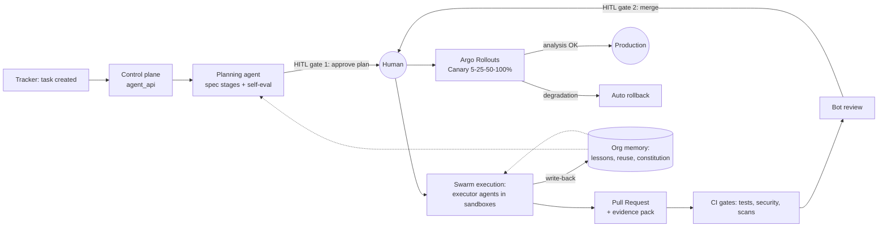
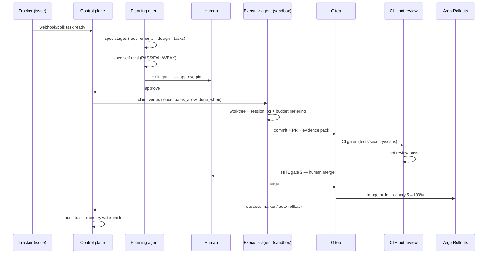
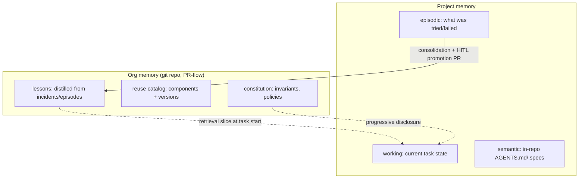

# ARCH — how the AI-Organisation works (diagrams)

Ground truth for architecture: the spec `docs/superpowers/specs/2026-11-07-swarm-dev-platform-design.md`
(§7 platform, §13 project lifecycle). This file is the visual map. Updated with each milestone.

## 1. Big picture — what the organisation does

The organization's goal: **develop, implement and support software projects**
(products, internal services, tools, assistants) with AI agent swarms doing the work
and humans holding the approval gates.



## 2. L0 stand topology (laptop, k3d/k3s — live now)

Everything provisions from scratch with `uv run org-bootstrap apply` (idempotent).

```mermaid
flowchart TB
    subgraph k3d["k3d cluster swarm-lab (k3s v1.35)"]
        subgraph platform["namespace: platform"]
            OB[OpenBao\nraft on PVC\nauto-init/unseal] 
            PG[Postgres 17 + pgvector\nCNPG operator\ndbs: gitea, openproject, litellm, swarm]
            GT[Gitea\ngit + PR + issues + OCI registry\nNodePort 30080]
            RUN[act_runner\ndind, PVC identity]
            AR[Argo CD\nNodePort 30081]
            KS[kube-prometheus-stack\nGrafana 30082 / Prometheus]
            LK[Loki + Alloy\ndaemonset: pod logs]
            OP[OpenProject\ntracker UI 30083\nauth broken — see TODO]
            LL[LiteLLM gateway\n30084 → host Ollama]
        end
        subgraph prod["namespace: prod"]
            PODINFO[podinfo demo\nGitOps-synced, debug logs]
        end
        AG[agent workers\n(M3+: claim vertices)]
    end
    OLL[(Host Ollama\nqwen2.5-coder:7b\ncolima VM 6CPU/24GB)]
    LL -->|hostAliases 192.168.5.2| OLL
    GH["GitHub (public)\ncanonical repo of this platform + CI"] -.-> AR
    TRK(("Tracker\n(task in)")) -.-> API
```

Ports: Gitea 30080, Argo CD 30081, Grafana 30082, OpenProject 30083, LiteLLM 30084.

## 3. Delivery pipeline — one task, end to end



Scaling principle (spec §8): the bottleneck is **verification capacity** (gates/review),
not generation. Merge queue + backpressure throttle the swarm to integration speed.

## 4. Swarm execution model

- **One writer per code area**; specialists review, never co-write.
- Roles: **coordinator** (plan/judge/memory rules) → **specialists** (architecture,
  security, tests) → **executors** (one vertex each, isolated worktree + pod, MCP tools).
- **brain / hands / session** separation (Pattern 19): the loop is the brain, the sandbox
  is the hands, and an append-only NDJSON **session log** survives crashes — a worker can
  die and the vertex resumes/requeues with evidence intact.
- Vertex contract: `{id, deps, paths_allow, paths_avoid, done_when, deliverable}`.
  `done_when` is validated by code, not by an LLM refusing to fail.

## 5. Memory (spec §7.4, ADR-0003)



Write rights by role; semantic changes only via PR; "published" ≠ "improves results"
(eval-gated). TTL/consolidation guards against drift and poisoning.

## 6. Control plane internals (current state, M3)

`agent_api` (FastAPI + SQLAlchemy async):

- **runs / vertices** — task graph, atomic claim with lease TTL + heartbeat, requeue on
  failure (`UPDATE ... RETURNING`, SKIP LOCKED on Postgres).
- **identities** — agent service identities (scoped, swappable).
- **budgets** — token burn per subject, atomic limit enforcement (`spent + X <= limit`).
- **HITL inbox** — pending decision cards; one decision per request (409 on double).
- **audit** — append-only event journal (actor/action/target/outcome/payload).
- **merge queue** — entries for integration serialization (gating logic lands in M5).

Enpoints: `/runs`, `/runs/{id}/vertices`, `/vertices/claim|heartbeat|complete|fail`,
`/identities`, `/budgets/{subject}[/consume]`, `/hitl[/pending|/decision]`, `/audit`,
`/merge-queue`, `/healthz`.

## 7. Executor model (M4, designed)

OpenCode harness runs **inside a k3s pod** (initContainer clone, NetworkPolicy
allow-list to LiteLLM/MCP/Gitea only, short-lived Vault token). The worker drives it via
REST/SSE: structured vertex prompt in, event stream → session log out, diff → PR.
`done_when` is validated by our code. Permission `ask` is bridged to the HITL inbox.
The same swarm engine also runs **Automations** (scans, dep updates, log analysis,
feedback ingestion) — outputs land as Inbox cards.

## 8. Verification map

```bash
uv run ruff check . && uv run mypy packages apps && uv run pytest   # platform code
./infra/tests/m2a_pr_flow.sh        # Gitea PR-flow + branch protection
./infra/tests/m2b_deploy_flow.sh    # GitOps → prod + metrics + logs
./infra/tests/m2c_flow.sh           # tracker issues → poller + LLM gateway
./infra/tests/m2d_flow.sh           # bootstrap CLI end-to-end
./infra/tests/m3_flow.sh            # control plane on live Postgres (M3, in progress)
```

Cross-references: full design §7.2 (pipeline), §7.3 (orchestration), §7.4 (memory),
§7.7 (HITL), §13 (project lifecycle); UI/Automations addendum 2026-11-08.
