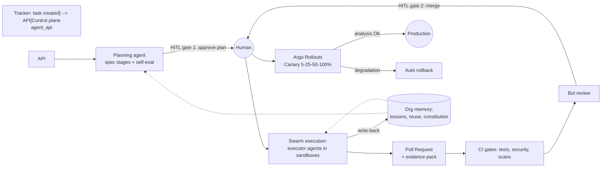
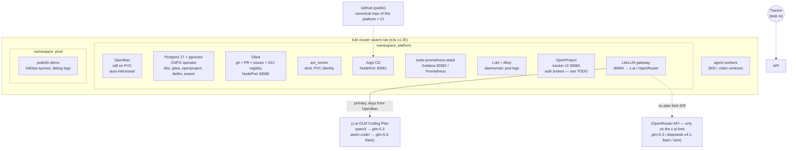
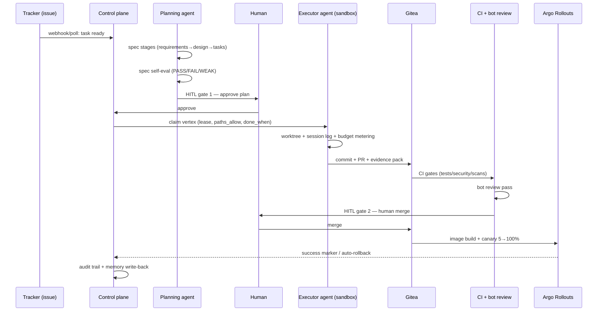
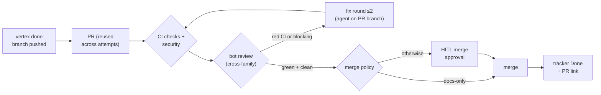
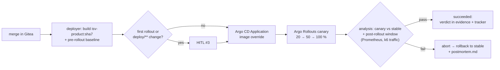
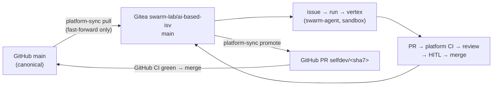
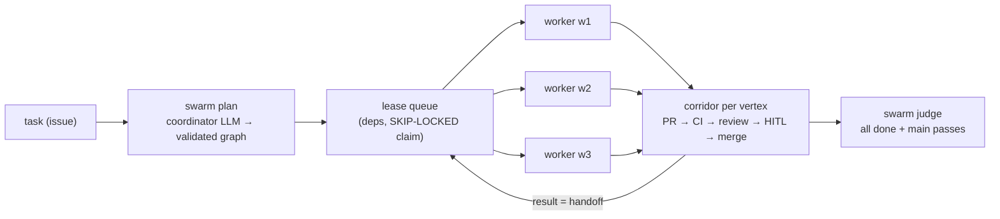
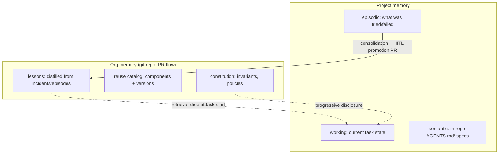

# ARCH — how the AI-Organisation works (diagrams)

Ground truth for architecture: the spec `docs/superpowers/specs/2026-11-07-swarm-dev-platform-design.md`
(§7 platform, §13 project lifecycle). This file is the visual map. Updated with each milestone.

## 1. Big picture — what the organisation does

The organization's goal: **develop, implement and support software projects**
(products, internal services, tools, assistants) with AI agent swarms doing the work
and humans holding the approval gates.



## 2. L0 stand topology (laptop, k3d/k3s — live now)

Everything provisions from scratch with `uv run org-bootstrap apply` (idempotent).



Ports: Gitea 30080, Argo CD 30081, Grafana 30082, OpenProject 30083, LiteLLM 30084.

## 3. Delivery pipeline — one task, end to end



Scaling principle (spec §8): the bottleneck is **verification capacity** (gates/review),
not generation. Merge queue + backpressure throttle the swarm to integration speed.

**Implemented since M5 (`agent_runtime/gates.py`, verified by `m5_flow.sh`):**
- After the vertex pushes `agent/vertex-N`, the worker drives the corridor:
  PR → CI → bot review → fix rounds (≤2) → HITL merge (or policy auto-merge for docs-only) → merge.
  The tracker gets a `[platform]` comment at each stage.
- CI is the repo's **check profile**, a Gitea Actions workflow seeded by the bootstrapper:
  - job `checks`: ruff, mypy, pytest;
  - job `security`: gitleaks, semgrep.
  `main` is protected by both contexts.
- The reviewer (LiteLLM alias `reviewer`) runs on z.ai `glm-5.3` like everything else — OpenRouter is used only on the z.ai plan limit (owner directive); its limit-time fallback is a different family (`moonshotai/kimi-k3.1-pro`). The reviewer prompt, not the model family, carries the independence while on z.ai.
- Every unknown or failed state blocks the merge. Agents can never change `.gitea/**` or `.platform/**`.



### 3b. Canary rollout (M6)



### 3a. Self-development loop (spec §13.7 level 2)

The platform repo itself is a target project. GitHub stays canonical; Gitea `swarm-lab/ai-based-isv` is the agents' working copy, synced by `infra/scripts/platform-sync.sh`. Agents act as the non-admin `swarm-agent`; every merge needs HITL (no auto-merge for `platform_repos`).



## 4. Swarm execution model

- **One writer per code area**; specialists review, never co-write.
- Roles: **coordinator** (plan/judge/memory rules) → **specialists** (architecture,
  security, tests) → **executors** (one vertex each, isolated worktree + pod, MCP tools).
- **brain / hands / session** separation (Pattern 19): the loop is the brain, the sandbox
  is the hands, and an append-only NDJSON **session log** survives crashes — a worker can
  die and the vertex resumes/requeues with evidence intact.
- Vertex contract: `{id, deps, paths_allow, paths_avoid, done_when, deliverable}`.
  `done_when` is validated by code, not by an LLM refusing to fail.

### 4·M8. Implemented swarm mode (v0.9.0)



- **Planner** (`agent_runtime.planner`): an LLM proposes `{name, deps, paths_allow}`; the platform validates it before anything runs. The checks:
  - names unique, deps known, no cycles, at most 5 vertices;
  - paths inside the task's allowed area;
  - **vertices that can run concurrently do not share files**.

  `done_when` is platform-supplied; the planner never gives commands. Any failure falls back to one vertex.
- **Parallel executors** (`swarm run --workers N`): N worker processes on one run, with distinct lease identities (`<agent>-w<i>`) and workspaces. Each vertex has its own sandbox pod and NodePort.
- **Handoffs:** a dependent vertex's prompt gets "Handoff from upstream vertices" (files, PR, review of each dep). The claim response carries `deps`, and `GET /runs/{id}/vertices` exposes the graph.
- **Backpressure:** a worker does not claim while at least `max_pending_merges` (default 3) merges wait for HITL. The wait is audited as `backpressure`.
- **Judge** (`swarm judge`): all vertices `done`, and the merged `main` passes the run's done command. Then the run is set `done`, and a `decision` episode goes to project memory.
- **Metrics:** `GET /metrics` on the control plane exposes `swarm_vertices{status}`, `swarm_hitl_pending{kind}` and `swarm_runs{status}`.

### 4·M9. Polyglot corridor

Stack-specific parts are data:
- check profiles in `infra/templates/check-profiles/<stack>`: `python`, `typescript`, `docs`;
- code templates in `infra/templates/projects/<name>`: `ts-service`.

The corridor, the agents, the reviewer, HITL and memory are stack-agnostic. `m9_flow.sh` proves it on a TypeScript service. The acceptance command for a foreign stack runs its toolchain in a container (e.g. `node:22` via docker), so the host needs no language runtime.

### 4·M10. Organization panel and Automations

- **Panel** `/ui` (agent_api, dependency-free ES modules): login for humans only (signed sessions, local users; OIDC later). The tabs are Inbox, Projects, Swarm, Automations, Metrics and Memory, with an EN/RU toggle. Every action goes through `/ui/api` and is audited under the human's name.
- **Automations:**
  - definitions are code (`infra/automations/*.yaml`);
  - the control plane stores runs (`automation_runs`);
  - the host engine (`agent_runtime.automations`) works, then files an Inbox card (HITL `automation`);
  - **actions happen only after a human approves**: for `vuln-scan`, one tracker issue per affected repo.

### 4·M11. The platform as a standing service

```
 host (Windows + Rancher Desktop)                       k3s (namespace platform)
 ┌─────────────────────────────────────────┐          ┌──────────────────────────────┐
 │ swarm-platform-daemon (toolbox image,   │  bearer   │ Argo CD app platform-control │
 │  --restart unless-stopped, .platform-live)├────────▶│  agent-api (swarm-platform)  │
 │  dispatcher: Gitea issues `swarm` → run  │  :30400   │  /ui panel (login)           │
 │   → plan → worker subprocesses → judge   │◀──────────┤  ServiceMonitor → Prometheus │
 │  automation poller: panel + cron         │           └──────────────────────────────┘
 │  workers → k3s sandboxes (agents ns)     │
 └─────────────────────────────────────────┘
```

- **Pinned code.** `platform.sh up` pins a commit (worktree `.platform-live`), builds `swarm-platform:<sha7>`, deploys it through Argo CD and (re)starts the daemon. Editing the dev tree never changes the running platform.
- **Intake.** Each repo's `.platform/project.yaml` (`intake`, `paths`, `done_when`, `deploy`, `workers_per_run`) is a protected gate file. The dispatcher owns runs whose project is `intake:<owner/repo>`, dedups by `task_ref` and caps the load at 2 active runs and 11 sandboxes. A restart re-adopts pending runs.
- **Service API.** The control plane requires a bearer token on service endpoints (stand NodePorts bind 0.0.0.0). The panel session may only read; actions go through `/ui/api`.
- **Hardening (M12).** One token per identity (`daemon`, `worker`, `poller`, operator), only their sha256 hashes in the cluster; only the operator decides HITL over the API; audit rows carry the caller's identity. The host-facing task-source MCP (:30085) needs its own bearer token; the firewall script keeps NodePorts loopback-only. Lifecycle: a SIGTERMed worker *releases* its vertex (`/vertices/{id}/release`, attempt given back) and tears its sandbox down; a failed task gets a new run through the `swarm-retry` label or the panel's Retry.

### 4a. Agent roles catalog

Implemented via the `identities` registry (M3): a role maps to `allowed_sections`
(gitea, ci, memory, litellm, deploy...) and to which stage of the pipeline the agent is
admitted. Humans hold separate accounts with HITL rights only.

| Role | Type | Responsibility | Pipeline stage | Tools/access |
|---|---|---|---|---|
| **planner** | specialist | task intake → spec stages, ask-questions, reuse lookup, seed tasks | before coding | tracker, memory |
| **architect** | specialist | review spec/design, invariants, reuse proposals, drift checks | spec + review | git read, memory |
| **developer** | executor | implement one vertex (code + local tests), respond to bot-review findings | execution (open-code harness) | git, gitea, ci, litellm |
| **tester** | specialist/executor | write/maintain tests, flaky hunter, coverage gaps, release-candidate acceptance runs | execution + release | git, ci, evals |
| **reviewer (bot)** | light agent | first-pass code review on PRs, dedup findings, severity labels | gates | gitea, ci read |
| **security** | specialist | SAST/dependency/secret scanning review, threat modeling, safe-harness audit | gates + automations | ci read, scanners |
| **judge** | light agent | completion judgment: `done_when` evidence check, session-log sanity — code validates, judge double-checks | per vertex + run | memory read |
| **support** | executor | support tickets, post-mortem drafts, regression reproductions | support loop | tracker, git, observability |
| **maintenance (janitor)** | executor | sweeps: dead code, orphaned tests, docs/OpenAPI drift, memory hygiene | automations | git, ci |
| **release** | executor | distribution builds: dist/archive, Docker images, checksums+SBOM (external projects, §13.5) | release channel | gitea registry, ci |

Automations reuse these roles with triggers (vuln-scan → security; dep-updates →
developer; log-analysis → support; feedback-ingest → planner). Humans: owner (HITL
decisions, memory promotion), champion (per-project config review), on-call (canary
alerts).

## 5. Memory (spec §7.4, ADR-0003)



Write rights by role; semantic changes only via PR; "published" ≠ "improves results"
(eval-gated). TTL/consolidation guards against drift and poisoning.

**Implemented in M7 (v0.8.0):**
- **Episodic store:** table `memory_episodes` in the control-plane DB, API `/memory/episodes`, `/memory/slice`.
  - Ranking: path overlap +3, shared task words up to +5, last 7 days +1, postmortem/failure +2.
  - No path and no word overlap means the episode is never returned.
- **Write-back** by the worker on vertex close, fail-open:
  - `deploy` (success marker) or `postmortem` (rollback);
  - `failure` (terminal fail, exhausted attempts);
  - `lesson` from the **memory-extractor** (light model, at most 2 per task).
- **Retrieval at vertex start:** the slice goes into the agent prompt ("Project memory (lessons from earlier tasks — follow them)"), and its ids into the session log (`memory_slice`).
- **Org memory:** the Gitea repo `swarm-lab/org-memory` holds `lessons/` and `reuse-catalog.yaml` (reuse catalog v1), under the docs check profile.
  - `org-bootstrap memory promote --episode N` opens a human-reviewed PR.
  - Agents never write org memory.
- **Deferred** (TODO): working memory (M8), embeddings, code indexing, spec self-evals, automatic promotion.

## 6. Control plane internals (current state, M3)

`agent_api` (FastAPI + SQLAlchemy async):

- **runs / vertices** — task graph, atomic claim with lease TTL + heartbeat, requeue on
  failure (`UPDATE ... RETURNING`, SKIP LOCKED on Postgres).
- **identities** — agent service identities (scoped, swappable).
- **budgets** — token burn per subject, atomic limit enforcement (`spent + X <= limit`).
- **HITL inbox** — pending decision cards; one decision per request (409 on double).
- **audit** — append-only event journal (actor/action/target/outcome/payload).
- **merge queue** — entries for integration serialization (gating logic lands in M5).

Enpoints: `/runs`, `/runs/{id}/vertices`, `/vertices/claim|heartbeat|complete|fail`,
`/identities`, `/budgets/{subject}[/consume]`, `/hitl[/pending|/decision]`, `/audit`,
`/merge-queue`, `/healthz`.

## 7. Executor model (M4, designed)

OpenCode harness runs **inside a k3s pod** (initContainer clone, NetworkPolicy
allow-list to LiteLLM/MCP/Gitea only, short-lived Vault token). The worker drives it via
REST/SSE: structured vertex prompt in, event stream → session log out, diff → PR.
`done_when` is validated by our code. Permission `ask` is bridged to the HITL inbox.
The same swarm engine also runs **Automations** (scans, dep updates, log analysis,
feedback ingestion) — outputs land as Inbox cards.

## 8. Verification map

```bash
uv run ruff check . && uv run mypy packages apps && uv run pytest   # platform code
./infra/tests/m2a_pr_flow.sh        # Gitea PR-flow + branch protection
./infra/tests/m2b_deploy_flow.sh    # GitOps → prod + metrics + logs
./infra/tests/m2c_flow.sh           # tracker issues → poller + LLM gateway
./infra/tests/m2d_flow.sh           # bootstrap CLI end-to-end
./infra/tests/m3_flow.sh            # control plane on live Postgres (M3)
./infra/tests/m4a_flow.sh           # M4a executor vertex: opencode serve in docker → session log + manifest + branch in Gitea
./infra/tests/m4b_flow.sh           # M4b executor vertex in a k3s sandbox pod: NetworkPolicy + per-run Secret + NodePort, Postgres denied
./infra/tests/m4c_flow.sh           # M4c full cycle: Gitea issue → poller via task-source MCP (dedup) → run → k3s agent with MCP (tracker, llm) → branch → issue closed with verdict
```

Cross-references: full design §7.2 (pipeline), §7.3 (orchestration), §7.4 (memory),
§7.7 (HITL), §13 (project lifecycle); UI/Automations addendum 2026-11-08.
