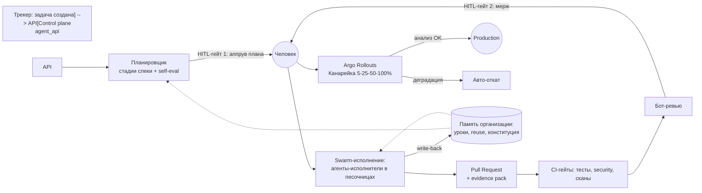
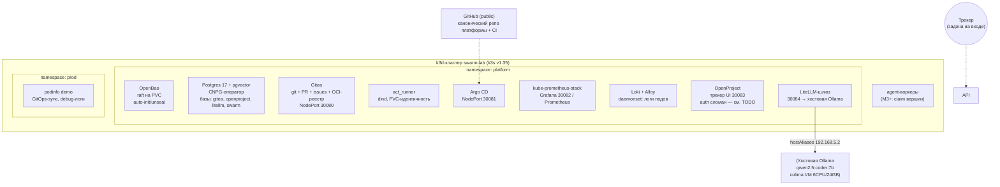
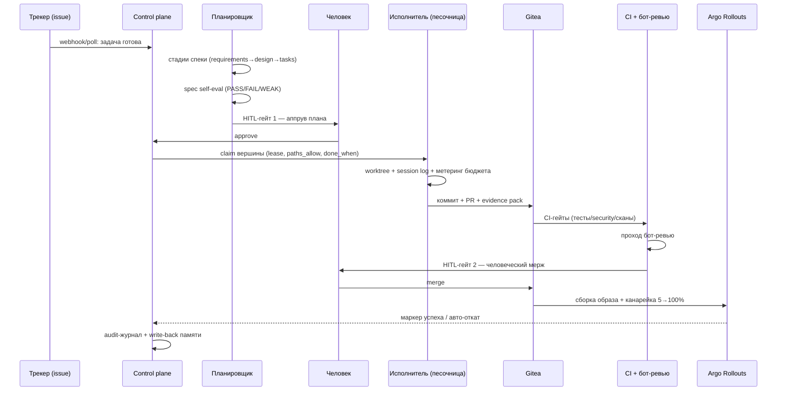
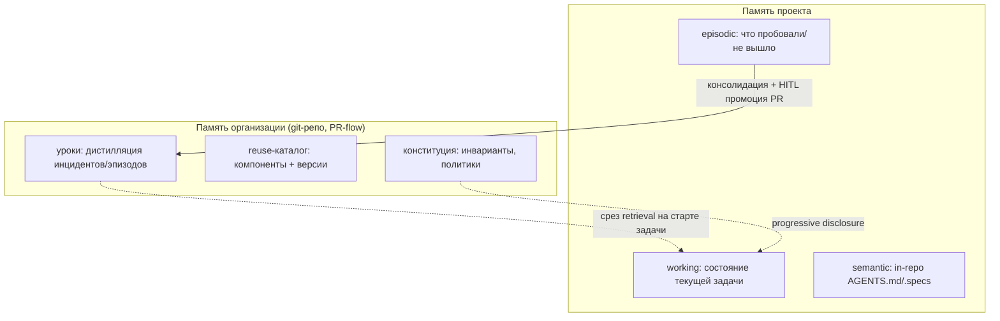

# ARCH — как работает AI-Организация (схемы)

> Русская версия: [ARCH.md](ARCH.md) (EN)

Архитектурная правда — в спеке `docs/superpowers/specs/2026-11-07-swarm-dev-platform-design.md`
(§7 платформа, §13 жизненный цикл проектов). Этот файл — визуальная карта; обновляется
с каждым инкрементом.

## 1. Общая картина — что делает организация

Цель организации: **разработка, внедрение и поддержка проектов ПО** (продукты,
внутренние сервисы, тулы, ассистенты) — работу выполняют рои AI-агентов, люди держат
гейты-утверждения.



## 2. Топология L0-стенда (ноутбук, k3d/k3s — работает сейчас)

Всё разворачивается с нуля: `uv run org-bootstrap apply` (идемпотентно).



Порты: Gitea 30080, Argo CD 30081, Grafana 30082, OpenProject 30083, LiteLLM 30084.

## 3. Конвейер доставки — одна задача от входа до prod



Принцип масштабирования (спека §8): узкое место — **пропускная способность проверки**
(гейты/ревью), а не генерации. Merge queue + backpressure ограничивают рой скоростью
интеграции.

## 4. Модель сворм-исполнения

- **Один писатель на участок кода**; специалисты ревьюят, не пишут совместно.
- Роли: **координатор** (план/judge/правила памяти) → **специалисты** (архитектура,
  security, тесты) → **исполнители** (по вершине, изолированный worktree + под, MCP-тулы).
- Разделение **brain / hands / session** (Паттерн 19): петля — мозг, песочница — руки,
  а append-only NDJSON **session log** переживает сбои — воркер может умереть, вершина
  переигрывается/возвращается с сохранёнными доказательствами.
- Контракт вершины: `{id, deps, paths_allow, paths_avoid, done_when, deliverable}`.
  `done_when` проверяется **кодом**, а не отказом LLM failing.

### 4a. Каталог ролей агентов

Реализуется через реестр `identities` (M3): роль маппится на `allowed_sections`
(gitea, ci, memory, litellm, deploy...) и на то, к какой стадии конвейера агент допущен.
Люди имеют отдельные аккаунты только с HITL-правами.

| Роль | Тип | Ответственность | Стадия конвейера | Доступ |
|---|---|---|---|---|
| **planner** | специалист | приём задачи → стадии спеки, уточняющие вопросы, lookup reuse, посев задач | до кода | трекер, память |
| **architect** | специалист | ревью спеки/дизайна, инварианты, предложения reuse, проверки дрейфа | спека + ревью | git read, память |
| **developer** | исполнитель | реализация одной вершины (код + локальные тесты), обработка замечаний бот-ревью | исполнение (open-code harness) | git, gitea, ci, litellm |
| **tester** | специалист/исполнитель | написание/поддержка тестов, flaky-hunter, покрытие, приёмка release-кандидата | исполнение + релиз | git, ci, evals |
| **reviewer (бот)** | лёгкий агент | первый проход код-ревью на PR, дедуп находок, severity-метки | гейты | gitea, ci read |
| **security** | специалист | ревью SAST/зависимости/секреты, threat modeling, аудит безопасного харнесса | гейты + automations | ci read, сканеры |
| **judge** | лёгкий агент | решение о завершении: проверка evidence по `done_when`, sanity session log | по вершине + руну | память read |
| **support** | исполнитель | тикеты поддержки, черновики пост-мортемов, воспроизведение регрессий | цикл поддержки | трекер, git, наблюдаемость |
| **maintenance (janitor)** | исполнитель | свипы: мёртвый код, осиротевшие тесты, дрейф док/OpenAPI, hygiene памяти | automations | git, ci |
| **release** | исполнитель | сборка дистрибутивов: архив, Docker-образы, checksums+SBOM (внешние проекты, §13.5) | канал релизов | gitea registry, ci |

Automations переиспользуют эти роли с триггерами (vuln-scan → security; dep-updates →
developer; log-analysis → support; feedback-ingest → planner). Люди: владелец (HITL,
промоция памяти), чемпион (ревью конфигурации проекта), дежурный (алерты канарейки).

## 5. Память (спека §7.4, ADR-0003)



Права записи по ролям; изменения semantic — только через PR; «опубликован» ≠
«улучшает результат» (eval-гейт). TTL/консолидация защищают от дрейфа и отравления.

## 6. Внутренности control plane (текущее состояние, M3)

`agent_api` (FastAPI + SQLAlchemy async):

- **runs / vertices** — граф задач, атомарный claim с lease TTL + heartbeat, возврат
  при сбое (`UPDATE ... RETURNING`, SKIP LOCKED на Postgres).
- **identities** — сервисные идентичности агентов (scoped, заменяемые).
- **budgets** — расход токенов по субъекту, атомарное ограничение (`spent + X <= limit`).
- **HITL-инбокс** — карточки решений; одно решение на запрос (409 при повторе).
- **audit** — append-only журнал событий (actor/action/target/outcome/payload).
- **merge queue** — записи для сериализации интеграции (гейтинг — M5).

Эндпоинты: `/runs`, `/runs/{id}/vertices`, `/vertices/claim|heartbeat|complete|fail`,
`/identities`, `/budgets/{subject}[/consume]`, `/hitl[/pending|/decision]`, `/audit`,
`/merge-queue`, `/healthz`.

## 7. Модель исполнителя (M4, дизайн)

OpenCode-харнесс работает **внутри пода k3s** (initContainer-клон, NetworkPolicy
allow-list только к LiteLLM/MCP/Gitea, краткосрочный Vault-токен). Воркер управляет им
через REST/SSE: структурированный промпт вершины на вход, поток событий → session log,
дифф → PR. `done_when` валидируется нашим кодом. Permission `ask` мостится в HITL-инбокс.
Тот же swarm-движок гоняет **Automations** (сканы, обновления зависимостей, анализ
логов, приём фидбека) — результаты попадают карточками в Inbox.

## 8. Карта верификации

```bash
uv run ruff check . && uv run mypy packages apps && uv run pytest   # код платформы
./infra/tests/m2a_pr_flow.sh        # Gitea PR-flow + branch protection
./infra/tests/m2b_deploy_flow.sh    # GitOps → prod + метрики + логи
./infra/tests/m2c_flow.sh           # задачи трекера → poller + LLM-шлюз
./infra/tests/m2d_flow.sh           # бутстреппер-CLI end-to-end
./infra/tests/m3_flow.sh            # control plane на живом Postgres (M3)
./infra/tests/m4a_flow.sh           # M4a: вершина-исполнитель, opencode serve в docker → session log + manifest + ветка в Gitea
./infra/tests/m4b_flow.sh           # M4b: вершина в k3s-поде-песочнице: NetworkPolicy + Secret на прогон + NodePort, Postgres закрыт
./infra/tests/m4c_flow.sh           # M4c: полный цикл — issue в Gitea → поллер через task-source MCP (дедуп) → run → агент в k3s с MCP (tracker, llm) → ветка → issue закрыт с вердиктом
```

Перекрёстные ссылки: полный дизайн §7.2 (конвейер), §7.3 (оркестрация), §7.4 (память),
§7.7 (HITL), §13 (жизненный цикл проектов); аддендум UI/Automations 2026-11-08.
