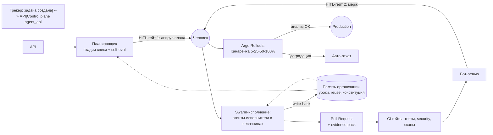
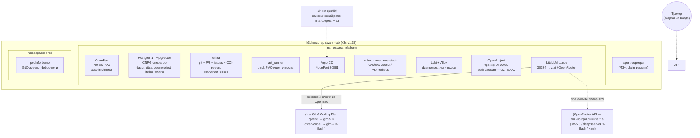
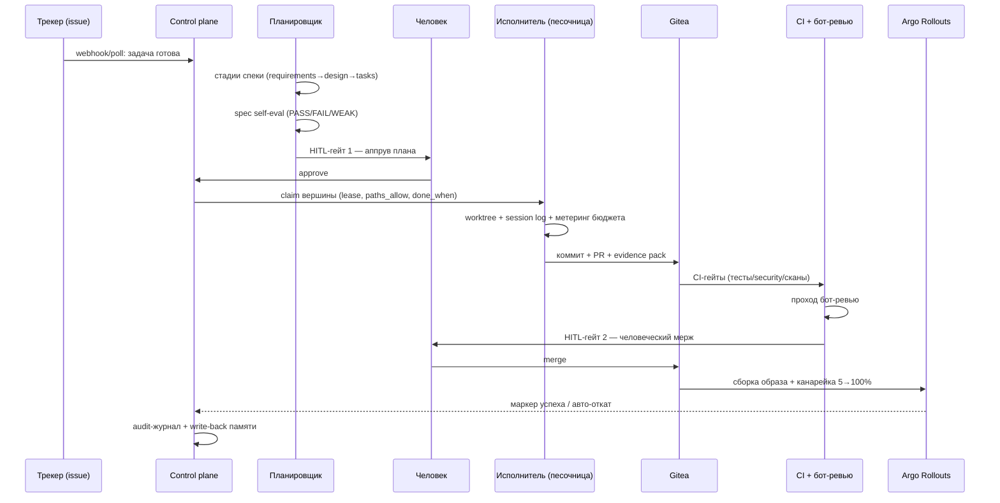
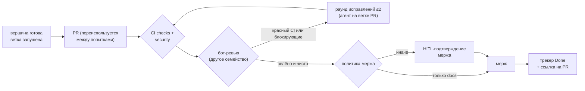
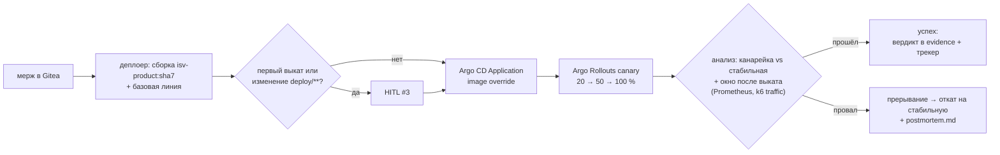
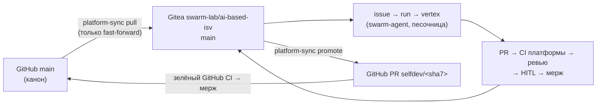
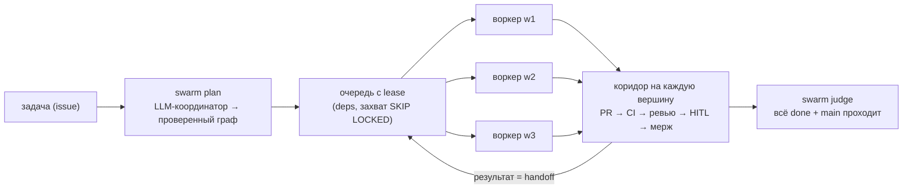
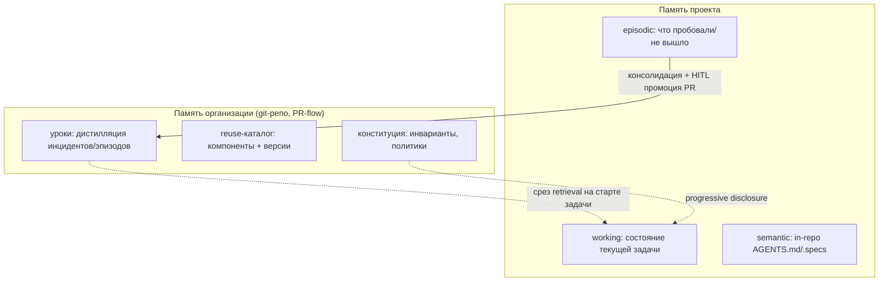

# ARCH — как работает AI-Организация (схемы)

> Русская версия: [ARCH.md](ARCH.md) (EN)

Архитектурная правда — в спеке `docs/superpowers/specs/2026-11-07-swarm-dev-platform-design.md`
(§7 платформа, §13 жизненный цикл проектов). Этот файл — визуальная карта; обновляется
с каждым инкрементом.

## 1. Общая картина — что делает организация

Цель организации: **разработка, внедрение и поддержка проектов ПО** (продукты,
внутренние сервисы, тулы, ассистенты) — работу выполняют рои AI-агентов, люди держат
гейты-утверждения.



## 2. Топология L0-стенда (ноутбук, k3d/k3s — работает сейчас)

Всё разворачивается с нуля: `uv run org-bootstrap apply` (идемпотентно).



Порты: Gitea 30080, Argo CD 30081, Grafana 30082, OpenProject 30083, LiteLLM 30084.

## 3. Конвейер доставки — одна задача от входа до prod



Принцип масштабирования (спека §8): узкое место — **пропускная способность проверки**
(гейты/ревью), а не генерации. Merge queue + backpressure ограничивают рой скоростью
интеграции.

**Реализовано с M5 (`agent_runtime/gates.py`, проверено `m5_flow.sh`):**
- После пуша `agent/vertex-N` воркер ведёт коридор:
  PR → CI → бот-ревью → раунды исправлений (≤2) → HITL-мерж (или авто-мерж по политике, если меняются только docs) → мерж.
  В трекер на каждом этапе уходит комментарий `[platform]`.
- CI — это **check-профиль** репо, workflow Gitea Actions, который раскладывает бутстрапер:
  - задача `checks`: ruff, mypy, pytest;
  - задача `security`: gitleaks, semgrep.
  `main` защищён обеими проверками.
- Ревьюер (алиас LiteLLM `reviewer`) работает на z.ai `glm-5.3`, как и всё остальное — OpenRouter только при исчерпании лимита z.ai (директива владельца); запасной на время лимита — модель другого семейства (`moonshotai/kimi-k3.1-pro`). Пока работаем на z.ai, независимость ревью держится на промпте ревьюера, а не на семействе модели.
- Любое неизвестное или сбойное состояние блокирует мерж. Агент никогда не меняет `.gitea/**` и `.platform/**`.



### 3b. Канареечный выкат (M6)



### 3a. Цикл самообеспечения (спека §13.7, уровень 2)

Репо самой платформы — тоже целевой проект. Канон — GitHub; рабочая копия агентов — Gitea `swarm-lab/ai-based-isv`, синхронизация — `infra/scripts/platform-sync.sh`. Агенты работают от не-админского `swarm-agent`; каждый мерж требует HITL (для `platform_repos` автомержа нет).



## 4. Модель сворм-исполнения

- **Один писатель на участок кода**; специалисты ревьюят, не пишут совместно.
- Роли: **координатор** (план/judge/правила памяти) → **специалисты** (архитектура,
  security, тесты) → **исполнители** (по вершине, изолированный worktree + под, MCP-тулы).
- Разделение **brain / hands / session** (Паттерн 19): петля — мозг, песочница — руки,
  а append-only NDJSON **session log** переживает сбои — воркер может умереть, вершина
  переигрывается/возвращается с сохранёнными доказательствами.
- Контракт вершины: `{id, deps, paths_allow, paths_avoid, done_when, deliverable}`.
  `done_when` проверяется **кодом**, а не отказом LLM failing.

### 4·M8. Реализованный режим роя (v0.9.0)



- **Планировщик** (`agent_runtime.planner`): LLM предлагает `{name, deps, paths_allow}`, платформа проверяет граф до запуска. Проверки:
  - имена уникальны, зависимости известны, циклов нет, вершин не больше 5;
  - пути внутри разрешённой области задачи;
  - **вершины, которые могут идти одновременно, не делят файлы**.

  `done_when` задаёт платформа, команд от планировщика нет. При любом сбое — откат к одной вершине.
- **Параллельные исполнители** (`swarm run --workers N`): N процессов-воркеров на один run, у каждого своя lease-идентичность (`<agent>-w<i>`) и рабочий каталог. У каждой вершины свой под-песочница и NodePort.
- **Handoff:** в промпт зависимой вершины попадает «Handoff from upstream vertices» — файлы, PR и ревью каждой зависимости. Ответ `claim` содержит `deps`, граф отдаёт `GET /runs/{id}/vertices`.
- **Backpressure:** воркер не берёт новую вершину, пока HITL ждут не меньше `max_pending_merges` мержей (по умолчанию 3). Ожидание аудитится как `backpressure`.
- **Judge** (`swarm judge`): все вершины `done`, и смерженный `main` проходит done-команду run. Тогда run получает статус `done`, а в память проекта пишется эпизод `decision`.
- **Метрики:** `GET /metrics` control plane отдаёт `swarm_vertices{status}`, `swarm_hitl_pending{kind}` и `swarm_runs{status}`.

### 4·M9. Полиглотный коридор

Всё, что зависит от стека, — это данные:
- check-профили в `infra/templates/check-profiles/<stack>`: `python`, `typescript`, `docs`;
- шаблоны кода в `infra/templates/projects/<name>`: `ts-service`.

Коридор, агенты, ревьюер, HITL и память от стека не зависят. `m9_flow.sh` доказывает это на TypeScript-сервисе. Приёмочная команда для чужого стека запускает его инструменты в контейнере (например, `node:22` через docker), поэтому рантайм языка на хосте не нужен.

### 4·M10. Панель организации и автоматизации

- **Панель** `/ui` (agent_api, ES-модули без зависимостей): вход только для людей (подписанные сессии, локальные пользователи; OIDC позже). Вкладки: Входящие, Проекты, Рой, Автоматизации, Метрики и Память, переключатель EN/RU. Каждое действие идёт через `/ui/api` и аудитится под именем человека.
- **Автоматизации:**
  - определения — это код (`infra/automations/*.yaml`);
  - прогоны хранит control plane (`automation_runs`);
  - движок на хосте (`agent_runtime.automations`) выполняет работу и создаёт карточку во «Входящих» (HITL `automation`);
  - **действия — только после одобрения человеком**: для `vuln-scan` это по одной задаче в трекере на каждый затронутый репо.

### 4a. Каталог ролей агентов

Реализуется через реестр `identities` (M3): роль маппится на `allowed_sections`
(gitea, ci, memory, litellm, deploy...) и на то, к какой стадии конвейера агент допущен.
Люди имеют отдельные аккаунты только с HITL-правами.

| Роль | Тип | Ответственность | Стадия конвейера | Доступ |
|---|---|---|---|---|
| **planner** | специалист | приём задачи → стадии спеки, уточняющие вопросы, lookup reuse, посев задач | до кода | трекер, память |
| **architect** | специалист | ревью спеки/дизайна, инварианты, предложения reuse, проверки дрейфа | спека + ревью | git read, память |
| **developer** | исполнитель | реализация одной вершины (код + локальные тесты), обработка замечаний бот-ревью | исполнение (open-code harness) | git, gitea, ci, litellm |
| **tester** | специалист/исполнитель | написание/поддержка тестов, flaky-hunter, покрытие, приёмка release-кандидата | исполнение + релиз | git, ci, evals |
| **reviewer (бот)** | лёгкий агент | первый проход код-ревью на PR, дедуп находок, severity-метки | гейты | gitea, ci read |
| **security** | специалист | ревью SAST/зависимости/секреты, threat modeling, аудит безопасного харнесса | гейты + automations | ci read, сканеры |
| **judge** | лёгкий агент | решение о завершении: проверка evidence по `done_when`, sanity session log | по вершине + руну | память read |
| **support** | исполнитель | тикеты поддержки, черновики пост-мортемов, воспроизведение регрессий | цикл поддержки | трекер, git, наблюдаемость |
| **maintenance (janitor)** | исполнитель | свипы: мёртвый код, осиротевшие тесты, дрейф док/OpenAPI, hygiene памяти | automations | git, ci |
| **release** | исполнитель | сборка дистрибутивов: архив, Docker-образы, checksums+SBOM (внешние проекты, §13.5) | канал релизов | gitea registry, ci |

Automations переиспользуют эти роли с триггерами (vuln-scan → security; dep-updates →
developer; log-analysis → support; feedback-ingest → planner). Люди: владелец (HITL,
промоция памяти), чемпион (ревью конфигурации проекта), дежурный (алерты канарейки).

## 5. Память (спека §7.4, ADR-0003)



Права записи по ролям; изменения semantic — только через PR; «опубликован» ≠
«улучшает результат» (eval-гейт). TTL/консолидация защищают от дрейфа и отравления.


**Сделано в M7 (v0.8.0):**
- **Эпизодическое хранилище:** таблица `memory_episodes` в БД control plane, API `/memory/episodes`, `/memory/slice`.
  - Ранжирование: пересечение путей +3, общие слова задачи до +5, последние 7 дней +1, postmortem/failure +2.
  - Эпизод без пересечения путей и слов не возвращается никогда.
- **Запись** воркером при закрытии вершины, fail-open:
  - `deploy` (маркер успеха) или `postmortem` (откат);
  - `failure` (терминальный провал, исчерпанные попытки);
  - `lesson` от **memory-extractor** (лёгкая модель, не больше 2 на задачу).
- **Retrieval на старте вершины:** срез попадает в промпт агента («Project memory (lessons from earlier tasks — follow them)»), а его id — в session log (`memory_slice`).
- **Org-память:** репо Gitea `swarm-lab/org-memory` с `lessons/` и `reuse-catalog.yaml` (reuse-каталог v1), под check-профилем docs.
  - `org-bootstrap memory promote --episode N` открывает PR на ревью человеку.
  - Агенты в org-память не пишут.
- **Отложено** (TODO): working-память (M8), эмбеддинги, индексация кода, self-evals спек, автопромоция.

## 6. Внутренности control plane (текущее состояние, M3)

`agent_api` (FastAPI + SQLAlchemy async):

- **runs / vertices** — граф задач, атомарный claim с lease TTL + heartbeat, возврат
  при сбое (`UPDATE ... RETURNING`, SKIP LOCKED на Postgres).
- **identities** — сервисные идентичности агентов (scoped, заменяемые).
- **budgets** — расход токенов по субъекту, атомарное ограничение (`spent + X <= limit`).
- **HITL-инбокс** — карточки решений; одно решение на запрос (409 при повторе).
- **audit** — append-only журнал событий (actor/action/target/outcome/payload).
- **merge queue** — записи для сериализации интеграции (гейтинг — M5).

Эндпоинты: `/runs`, `/runs/{id}/vertices`, `/vertices/claim|heartbeat|complete|fail`,
`/identities`, `/budgets/{subject}[/consume]`, `/hitl[/pending|/decision]`, `/audit`,
`/merge-queue`, `/healthz`.

## 7. Модель исполнителя (M4, дизайн)

OpenCode-харнесс работает **внутри пода k3s** (initContainer-клон, NetworkPolicy
allow-list только к LiteLLM/MCP/Gitea, краткосрочный Vault-токен). Воркер управляет им
через REST/SSE: структурированный промпт вершины на вход, поток событий → session log,
дифф → PR. `done_when` валидируется нашим кодом. Permission `ask` мостится в HITL-инбокс.
Тот же swarm-движок гоняет **Automations** (сканы, обновления зависимостей, анализ
логов, приём фидбека) — результаты попадают карточками в Inbox.

## 8. Карта верификации

```bash
uv run ruff check . && uv run mypy packages apps && uv run pytest   # код платформы
./infra/tests/m2a_pr_flow.sh        # Gitea PR-flow + branch protection
./infra/tests/m2b_deploy_flow.sh    # GitOps → prod + метрики + логи
./infra/tests/m2c_flow.sh           # задачи трекера → poller + LLM-шлюз
./infra/tests/m2d_flow.sh           # бутстреппер-CLI end-to-end
./infra/tests/m3_flow.sh            # control plane на живом Postgres (M3)
./infra/tests/m4a_flow.sh           # M4a: вершина-исполнитель, opencode serve в docker → session log + manifest + ветка в Gitea
./infra/tests/m4b_flow.sh           # M4b: вершина в k3s-поде-песочнице: NetworkPolicy + Secret на прогон + NodePort, Postgres закрыт
./infra/tests/m4c_flow.sh           # M4c: полный цикл — issue в Gitea → поллер через task-source MCP (дедуп) → run → агент в k3s с MCP (tracker, llm) → ветка → issue закрыт с вердиктом
```

Перекрёстные ссылки: полный дизайн §7.2 (конвейер), §7.3 (оркестрация), §7.4 (память),
§7.7 (HITL), §13 (жизненный цикл проектов); аддендум UI/Automations 2026-11-08.
